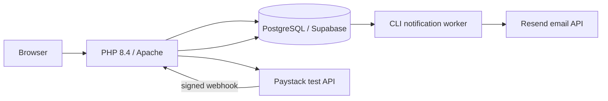

# EventMS System Documentation

This guide describes the application as implemented in this repository. It is intended for developers, administrators, and deployment operators. It does not include secret values. Keep credentials in the hosting environment or a local, untracked environment file.

## 1. System at a glance

EventMS is a server-rendered event discovery and booking marketplace. Attendees discover events and reserve tickets; organizers manage events and check-in; administrators manage accounts, platform settings, payments, refunds, reports, and audit records.



The site uses PHP templates and forms rather than a separate SPA or REST backend. PostgreSQL is the source of truth. The only public integration callback implemented is the Paystack webhook. Payment initiation, verification, refunds, and settlement-account actions are server-side.

### Technology and runtime

| Area | Implementation |
|---|---|
| Server | PHP 8.4 with Apache in the provided Docker image |
| Database | PostgreSQL through PDO and `pdo_pgsql` |
| PHP extensions | `pdo_pgsql`, `mbstring` |
| UI | Server-rendered PHP, `assets/css/main.css`, and vanilla JavaScript in `assets/js/script.js` |
| UI assets | Unsplash-hosted event photography; Fraunces and Inter Tight from Google Fonts |
| Payment | Paystack adapter; application enforces test mode |
| Email | Resend API, dispatched from a database outbox worker |
| Hosting files | Render Blueprint and Docker configuration; Supabase PostgreSQL is documented as the database deployment |
| Package managers | No Composer or npm manifest is present in the project root |

The ticket page loads QRCode.js from cdnjs and the admin reports page loads Chart.js from jsDelivr. Those pages need those CDN hosts reachable. Event photography and Google Fonts also require outbound browser access; the CSS declares local/system font fallbacks.

## 2. Repository map

```text
/
├── index.php, browse_events.php, event_details.php   Public discovery pages
├── login.php, register.php, logout.php               Authentication entry points
├── 404.php                                            Branded not-found page
├── admin/                                             Administrator pages
├── attendee/                                          Attendee pages
├── organizer/                                         Organizer pages
├── includes/
│   ├── header.php, footer.php                         Shared navigation and page chrome
│   ├── functions.php                                  Shared helpers and authorization
│   ├── payments/                                      Payment adapter, orchestration, money, webhook verification
│   └── mailer/ResendMailer.php                        Resend client
├── webhooks/paystack.php                              Signed payment/refund callback
├── scripts/process_notification_outbox.php            CLI email delivery worker
├── config/database.php                                Database, security headers, HTTPS/session setup
├── assets/css/main.css                                Shared design system and page styles
├── assets/js/script.js                                Vanilla progressive enhancements
├── database_setup_postgresql.sql                      Initial schema and in-file migrations
├── Dockerfile, docker-entrypoint.sh, render.yaml      Container and Render configuration
├── DEPLOYMENT.md                                      Render/Supabase deployment instructions
└── SYSTEM_DOCUMENTATION.md                            This guide
```

`assets/css/style.css` may still exist as a historical stylesheet; templates should use `main.css`. Uploaded event covers are stored under `assets/event-covers/` using generated names. Do not store payment secrets or database exports in the public asset directory.

## 3. User roles and access

### Administrator

The administrator account is configured using `APP_ADMIN_USERNAME` and `APP_ADMIN_PASSWORD`; it is not a normal row in `Organizers_007` or `Attendees_007`. The login handler compares the submitted credentials to these environment values. Admin-only pages call `requireRole(['admin'])`.

Administrator pages:

| Route | Purpose |
|---|---|
| `admin/dashboard.php` | Platform overview |
| `admin/manage_users.php` | Create approved organizers; approve, reject, ban, or delete organizer accounts; view paginated organizer and attendee lists |
| `admin/audit_logs.php` | Browse audit activity and inspect a selected record |
| `admin/export_logs.php` | Export audit records |
| `admin/reports.php` | Reporting and charts |
| `admin/backup.php` | Create/download and restore application database backups |
| `admin/payments.php` | Review marketplace payment allocations and transaction status |
| `admin/payment_settings.php` | Configure the default commission, test checkout enablement, and review organizer payment accounts |
| `admin/refunds.php` | Approve or reject refund requests and track provider status |
| `admin/profile.php` | Administrator profile/settings view |
| `admin/logout.php` | End the administrator session |

The create-organizer action sets the account to approved and stores a password hash. The organizer then signs in through `login.php` using the username or email and password supplied by the administrator. Use a temporary password handoff process outside the application and require an operational password-change procedure; do not send credentials in audit notes or this documentation.

### Organizer

Organizer-only routes call `requireRole(['organizer'])`.

| Route | Purpose |
|---|---|
| `organizer/dashboard.php` | Organizer metrics, event list, and payment overview |
| `organizer/create_event.php` | Create an event, choose a venue, set dates/capacity/price/category, and upload a cover |
| `organizer/my_events.php` | List and manage the organizer’s events |
| `organizer/edit_event.php` | Edit an owned event |
| `organizer/view_booking.php` | Review attendee bookings for an owned event |
| `organizer/ticket_types.php` | Manage ticket categories, prices, quantities, and sale windows |
| `organizer/check_in.php` | Find/check in attendees at an owned event |
| `organizer/payment_account.php` | Submit/refresh settlement account verification and view masked account information |
| `organizer/transactions.php` | Review transaction allocations for the organizer’s events |
| `organizer/profile.php` | Edit organizer profile and password |
| `organizer/logout.php` | End the organizer session |

There is no public organizer self-registration route in the current UI. An administrator creates an organizer account.

### Attendee

Attendee-only routes call `requireRole(['attendee'])` or require a signed-in user.

| Route | Purpose |
|---|---|
| `register.php` | Create an attendee account |
| `attendee/dashboard.php` | Attendee overview |
| `attendee/browse_events.php` | Authenticated event browsing |
| `attendee/book_ticket.php` | Free/cash reservation and online-checkout entry |
| `attendee/checkout.php` | Start Paystack hosted checkout |
| `attendee/payment_result.php` | Verify/display the result after provider redirect |
| `attendee/my_bookings.php` | View bookings and request eligible actions |
| `attendee/ticket.php` | View a ticket/QR code or booking status; ticket download is also supported |
| `attendee/request_refund.php` | Submit a refund request for an eligible paid booking |
| `attendee/profile.php` | Edit attendee profile and password |
| `attendee/logout.php` | End the attendee session |

The public login page detects administrator, organizer, or attendee credentials and redirects each role to its dashboard. Sessions are regenerated on successful login/registration where implemented.

## 4. Shared application components

### `config/database.php`

Creates the PDO PostgreSQL connection, enables exception mode and native prepared statements, configures security response headers, detects HTTPS behind the configured proxy, and starts a strict cookie-only session with `HttpOnly`, `Secure` when HTTPS is detected, and `SameSite=Lax`.

The response policy includes CSP, frame protections, content-type sniffing protection, referrer policy, permissions policy, and HSTS on HTTPS. The CSP allows the app’s self-hosted code, Google Fonts, Unsplash images, and the existing Chart.js/QRCode.js script CDNs. Inline scripts remain permitted for legacy page scripts; avoid adding new inline scripts when extending the UI.

### `includes/functions.php`

Shared helpers include:

- Base URL and versioned asset URL generation, including Render HTTPS/proxy handling.
- Event category/image selection and safe event-cover upload handling.
- Session role lookup and `requireLogin`/`requireRole` redirects.
- Flash messages, form CSRF tokens, nonce helpers, and escaping/sanitization helpers.
- PDO query wrappers (`fetchOne`, `fetchAll`, `executeQuery`).
- Password hashing/verification, dates/currency/phone formatting, and status labels.
- Ticket availability, ticket number generation, pagination, CSV output, and login throttling.
- Audit event recording with value redaction.

Use prepared statements for SQL that contains user-controlled values. Escape output for its HTML context and keep authorization checks on the server.

### `includes/header.php` and `includes/footer.php`

The header provides the shared EventMS wordmark, public navigation, responsive menu, role-aware dashboard/profile links, and flash-message region. The footer provides discovery/organizer links and loads the local JavaScript. Role-specific navigation is primarily inside each role’s pages rather than exposed as a universal menu.

### Frontend files

- `assets/css/main.css` contains the design tokens, responsive layout, public marketplace, authentication, dashboards, forms, ticket styling, and legacy server-rendered layout compatibility. It is intentionally kept below the requested 40 KB unminified target.
- `assets/js/script.js` implements mobile navigation, account dropdown, alert dismissal, existing audit modal controls, password toggles, form submission state, countdowns, accessible icon rendering, responsive table labels, and section reveal behavior. Core pages remain server-rendered and usable without client-side routing.
- The current visual identity uses warm paper/ink neutrals, burnt orange, Fraunces display text, and Inter Tight body text. Hero and event photography is loaded from Unsplash; event uploads are served from the app’s assets directory.

## 5. Main user workflows

### Event discovery

1. `index.php` loads the next three published events and links each event card to its detail page. It also provides keyword, date, and city search and category links.
2. `browse_events.php` accepts `search`, `date_from`, `date_to`, `category`, `city`, `sort`, and `page` query parameters. It filters published future events and paginates the result set.
3. `event_details.php?event_id=…` displays a published future event, venue, organizer, availability, and active ticket types. Booking continues through the attendee route.

The public event pages show database event information. Unsplash photos are fallback/illustrative photography; an organizer-uploaded cover is used when it passes the application’s accepted path and file checks.

### Event creation and publication

An approved organizer creates an event with an existing venue, future start date, optional later end date, nonnegative ticket price, category, capacity within venue capacity, and optional cover image. A General Admission `TicketTypes_007` record is created with the event. Events may be saved as draft or published. The organizer can later edit the event, manage ticket types, inspect bookings, and check attendees in.

### Ticket reservation and online payment

There are two related booking paths:

- The legacy `BookTicket_007` database function supports reservation/payment-method records used by the cash/free booking flow. Reservations have an expiry and are excluded from available capacity after cancellation/expiry.
- `PaymentService::startCheckout` handles hosted online checkout. It validates quantity/email, requires admin-enabled payment settings and a provider-verified organizer subaccount, locks the event and ticket type, expires stale reservations, validates both ticket-type and event capacity, and snapshots the GHS gross amount and commission. Online reservations expire after 15 minutes. Each attempt receives a random `evt_…` reference and unique idempotency key.

Paystack checkout is initialized with GHS and a hosted authorization URL. The application checks the URL is HTTPS and on a Paystack host before redirecting. The browser redirect alone does not confirm payment: `PaymentService::verifyAndConfirm` independently verifies the reference, status, amount, currency, attendee email when present, commission snapshot when present, and organizer subaccount. It creates one ticket per reserved unit and records the verified payment, gateway fee, organizer allocation, and paid booking in a database transaction. Repeated verification is designed to be idempotent.

Commission is configured by the administrator as a platform-wide default in basis points and snapshotted on each booking. Monetary payment calculations use integer minor units through `includes/payments/Money.php`. The organizer allocation is gross less commission and provider fee. The stored allocation is not proof that a bank settlement has completed.

### Webhook and email confirmation

`webhooks/paystack.php` accepts POST only, limits payload size, verifies Paystack signatures using test-mode secrets, hashes payloads for deduplication, records webhook processing state, and independently verifies successful charges. It also reconciles supported Paystack refund events against the provider before updating refund/booking state. Duplicate webhook deliveries are safe to retry.

After a paid booking is confirmed, a `NotificationOutbox_007` row is queued. Run `php scripts/process_notification_outbox.php` from the CLI to send booking-confirmation email through Resend. The worker claims jobs with PostgreSQL row locks/`SKIP LOCKED`, retries failures with backoff, and uses an idempotency key. Schedule it separately; it is not a web request or an automatic Render cron in the checked-in Blueprint.

### Refunds

An attendee may request a refund for an eligible successful paid booking. The current request page records the full booking gross amount and moves the booking to `refund_pending`; it does not directly refund money. An administrator approves or rejects the request. Approval calls Paystack and leaves the refund processing until a provider callback/status confirms the outcome. Completed full refunds cancel the booking’s tickets. Provider settlement reversal must be reconciled separately; the app does not claim that a completed provider refund reversed a prior organizer payout.

## 6. Database model

The authoritative schema and migrations are in [`database_setup_postgresql.sql`](database_setup_postgresql.sql). Most table names end in `_007` for this application’s schema naming convention.

| Table/group | Responsibility and principal relationships |
|---|---|
| `Organizers_007` | Organizer credentials, contact details, approval status |
| `Attendees_007` | Attendee credentials, contact details, loyalty points |
| `Venues_007` | Venue details and positive capacity |
| `Events_007` | Organizer-owned event, venue, dates, category, price, capacity, status, cover path |
| `TicketTypes_007` | Event-specific ticket category, price in minor units, quantity, active flag, sale window |
| `BookingOrders_007`, `BookingItems_007` | Reservation/order header and ticket type/quantity/price snapshots; ties attendee, event, and organizer together |
| `Tickets_007` | Individual ticket number/status, attendee/event, optional order/type, expiry, check-in time |
| `Payments_007` | Legacy ticket-level cash/payment status records |
| `MarketplacePayments_007` | Paystack transaction reference, idempotency, amount/currency/status, provider transaction and fee |
| `OrganizerPaymentAccounts_007` | One organizer’s Paystack subaccount and masked settlement account details/review status |
| `PlatformPaymentSettings_007` | Singleton platform commission, fee payer, refund mode, test checkout toggle |
| `PaymentRefunds_007` | Refund request/approval/provider status linked to marketplace payment |
| `PaymentSettlements_007` | Imported provider settlement references/status; not an automatic bank-payout guarantee |
| `PaymentWebhookEvents_007` | Verified webhook event hash/type/reference and processing status; unique provider/payload hash |
| `NotificationOutbox_007` | Durable booking-confirmation email work items and retry state |
| `Audit_Log_007`, `LoginAttempts_007` | Administrative/activity audit records and authentication throttling state |
| `EventFavorites_007`, `EventWaitlist_007`, `AccountTokens_007` | Supporting schema for favorites, waitlists, and hashed verification/reset tokens |
| `Vendors_007`, `Event_Vendors_007` | Vendor and event/vendor service association schema |

Database functions include `BookTicket_007`, `CancelBooking_007`, `ExpireReservations_007`, and `PromoteWaitlist_007`. Triggers maintain timestamps and audit ticket/event changes. Indexes cover event owner/venue/date/category, attendee tickets, payment/audit lookups, order expiry, webhook references, refunds, and outbox claiming. Constraints enforce positive capacities/quantities, valid statuses, unique transaction/ticket references, GHS marketplace currency, and booking/event/attendee ownership relationships.

The SQL file contains an initial schema plus named core and feature-expansion sections for an already initialized database. For a new empty database, run the entire file once. For a database that already contains data, follow the migration order in `DEPLOYMENT.md`, take a backup first, and do not rerun the complete initial setup over live data.

## 7. Configuration reference

Set these as environment values. The names below are configuration keys, not secret values.

| Variable | Purpose / guidance |
|---|---|
| `DB_HOST` | PostgreSQL host; local default is `127.0.0.1` |
| `DB_PORT` | PostgreSQL port; default `5432` |
| `DB_NAME` | Database name; local default `event_management` |
| `DB_USER` | Database user; local default `postgres` |
| `DB_PASSWORD` | Database password; required in real deployments |
| `DB_SSLMODE` | PostgreSQL TLS mode; local default `prefer`, hosted deployment should use the provider’s required mode |
| `APP_ADMIN_USERNAME` | Environment-backed administrator login name |
| `APP_ADMIN_PASSWORD` | Environment-backed administrator password; use a long unique secret |
| `APP_DEBUG` | Debug output is enabled only when set to `1` and the request is from loopback; keep off in hosted environments |
| `APP_TRUST_PROXY` | Set to `1` only when the app is behind a trusted proxy that supplies the forwarded protocol header |
| `APP_BASE_PATH` | Optional application subpath used in generated URLs |
| `RENDER`, `RENDER_EXTERNAL_URL` | Render-provided deployment values used to infer the public HTTPS scheme |
| `PAYSTACK_MODE` | Must be `test` for the current payment implementation |
| `PAYSTACK_TEST_SECRET_KEY` | Paystack test API secret; server-side only |
| `PAYSTACK_TEST_WEBHOOK_SECRET` | Paystack test webhook signing secret; server-side only |
| `RESEND_API_KEY` | Resend API secret used by the CLI email worker |
| `RESEND_FROM_EMAIL` | Verified sender address configured in Resend |

Never add actual values to this file, SQL, screenshots, logs, or source control. `render.yaml` marks credentials as unsynchronized values that must be supplied in the Render dashboard. See [`DEPLOYMENT.md`](DEPLOYMENT.md) for the hosted setup steps.

## 8. Local development and deployment

### Local XAMPP

1. Install/start PostgreSQL and create an empty development database.
2. Enable the PHP `pdo_pgsql` and `mbstring` extensions in the PHP instance Apache actually runs.
3. Set the database/admin environment variables for Apache; a shell-only variable may not be inherited by the Apache service.
4. Run the complete setup SQL once against a new database.
5. Serve this folder as the application document root and open `index.php` through Apache. Database-backed pages cannot render without a reachable PostgreSQL server.
6. Keep `APP_DEBUG` off except for loopback development.

The local PHP setup needs `pdo_pgsql`; PHP syntax checking alone does not test database queries or page rendering.

### Render and Supabase

The checked-in Docker image installs `pdo_pgsql` and `mbstring`, turns off `display_errors`, enables error logging, and configures Apache to listen on Render’s `PORT`. It blocks HTTP access to `admin/backups`. `render.yaml` defines a Docker web service and declares the expected environment keys. Follow `DEPLOYMENT.md` for Supabase connection, initial SQL/migration, webhook URL, and notification-worker setup.

Render’s local filesystem is ephemeral on the documented free plan. Database backup files and local file uploads need a persistent/object-storage strategy for reliable production operation. PHP’s default file-backed sessions also mean a restart can sign users out and multiple instances need shared session storage.

## 9. Security and operational controls

- Server-side role guards protect admin, organizer, and attendee route groups.
- State-changing forms use CSRF tokens where implemented; webhook requests use provider signature verification instead.
- Attendee and organizer passwords are stored as password hashes. The virtual administrator credential is read from environment settings and is not stored in the user tables. Login failures are rate-limited using `LoginAttempts_007`.
- PDO exception mode and prepared statements are enabled. Do not concatenate untrusted input into SQL.
- HTML output is escaped in the server-rendered templates. Continue context-aware escaping for any new content.
- Sessions use strict mode, cookie-only IDs, `HttpOnly`, `SameSite=Lax`, and `Secure` on HTTPS.
- Event upload paths are generated/validated by the upload helper; do not accept arbitrary filesystem paths or serve executable uploads.
- Payment secrets are server-side only. Card information is handled by Paystack’s hosted checkout; the application does not store PAN/CVV data.
- Checkout pricing and commission are recalculated/snapshotted server-side. Capacity is protected using transaction locks and reservations.
- Payment references, provider payload hashes, refund references, and notification idempotency keys are unique in the schema.
- Audit logging redacts sensitive values. Avoid logging secrets or full bank account numbers.
- Backups can contain personal data. Restrict access, encrypt storage outside this web container, and define retention.

Security controls are not a substitute for deployment review. In particular, inspect any new form/action for role checks, CSRF, validation, output escaping, and transaction boundaries.

## 10. Current scope boundaries and known gaps

These points are important when describing the product or planning production work:

1. **Payments are test-mode only.** The adapter interface has Paystack operations, but only `PaystackGateway` is implemented. A Flutterwave adapter is not present. Live mode is deliberately rejected.
2. **Provider and marketplace readiness is external.** Paystack subaccount eligibility, KYC, fee behavior, settlement timing, and reversals require provider/account approval. The database allocation is not confirmation of bank settlement.
3. **Email scope is limited.** Resend sends queued booking-confirmation email after verified paid checkout. Account verification and password-reset delivery are not wired as complete user workflows, despite supporting columns/token schema.
4. **Favorites and waitlists are not a complete attendee-facing feature.** Supporting tables and a waitlist-promotion database function exist, but a full user-facing save/join/manage workflow is not exposed by the current route set.
5. **Vendor tables are schema-only in the current route inventory.** There is no vendor management page group.
6. **Settlement synchronization is manual/not complete.** `PaymentSettlements_007` exists, but dashboard wording and deployment notes distinguish verified allocations from actual payout confirmation.
7. **Worker scheduling is operator-managed.** The outbox worker must be scheduled separately; the checked-in Render Blueprint does not provision that schedule.
8. **Persistence/scaling needs follow-up.** Render local files are ephemeral, and default PHP sessions are local to an instance.
9. **Automated test suite not found.** There is no test runner or test directory in the current repository inventory. Payment failure/concurrency, browser accessibility, and real viewport checks need a separately established test/staging setup.
10. **Some UI assets are remote.** Unsplash photos, Google Fonts, Chart.js, and QRCode.js need their respective external hosts; fallback fonts exist, but charts/QR rendering depend on their libraries.

## 11. Maintenance conventions

- Preserve server-side field names, routes, ownership checks, CSRF validation, and business rules when changing templates.
- Make schema changes in `database_setup_postgresql.sql` and document whether a change is safe for new installs, existing installs, or both.
- Use integer minor units through `Money` and the payment service for marketplace amounts; avoid floating-point financial arithmetic.
- Keep provider code behind `PaymentGatewayInterface`; do not scatter raw provider HTTP calls through page handlers.
- Keep outgoing email work asynchronous through `NotificationOutbox_007` for payment confirmation.
- Add no secret values to sample configs. Update both this file and `DEPLOYMENT.md` when environment variables or operational steps change.
- Re-run PHP syntax validation after PHP changes and perform database-backed/browser verification in a configured local or staging environment.
